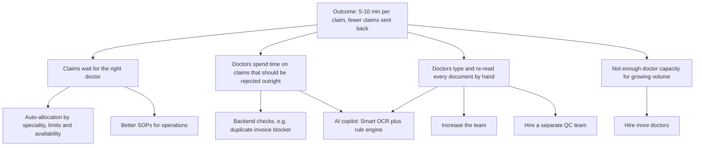

# Day 10 : Proof of work

**Date completed:** 2026-11-02 · **Time spent:** 7-8 hrs

## Success criteria

| **Criterion** | **Done?** | **POW** |
|---|---|:---|
| Frames a problem and its riskiest assumption | Yes | [Exercise 1](#exercise-1-the-problem-and-the-riskiest-assumption) |
| Writes a spec with acceptance criteria | Yes | [Exercise 2](#exercise-2-a-short-spec-with-acceptance-criteria); BEE's [Phase 1 spec](https://github.com/shaswatmishra-work/coe-shaswat/blob/main/smart-ocr-v1-phase-1-spec-day-10.md) |
| Makes a cost case and ranks it | Yes | [Exercise 3](#exercise-3-the-cost-case-and-the-ranking) |
| Defines success criteria and a test set | Yes | [Exercise 4](#exercise-4-success-criteria-and-the-golden-test-set) |
| Designs for trust and human review | Yes | [Exercise 5](#exercise-5-human-in-the-loop-and-trust-design) |
| Builds a working prototype of the core flow | Yes | [Exercise 6](#exercise-6-the-prototype); [live prototype](https://claude.ai/artifact/NcpmCEKtkrQsR5wPaw51ea); [source code](https://github.com/shaswatmishra-work/coe-shaswat/blob/main/smart-ocr-prototype.html) |
| Writes a comprehensive reflection | Yes | [Reflection](#reflection) |

## Key learnings

The capstone uses Smart OCR from Visit Health, my last company, an Indian health benefits platform. Members raise reimbursement claims by uploading a prescription and an invoice, and doctors review each claim on our tool, Maori, to approve it, reject it or approve part of it. Smart OCR reads the prescription and fills in its details for the doctor. It was the first part of a larger AI copilot that helped doctors adjudicate claims.

The problem, options and ranking cover the whole copilot, because that was the decision we faced. The spec, test set and prototype cover Smart OCR v1, its first slice: reading the date, doctor name and patient name.

### Claude artifacts

Artifacts are interactive outputs that open next to the chat when Claude makes something substantial, such as a document, code, an HTML page, an SVG, a diagram or a React component. In my opinion they work best for:

1. No setup: a working prototype, dashboard, calculator or tool without a repo, environment or deployment.
2. Sharing with non-technical people: a stakeholder opens a link without installing anything. For a PM, that suits a clickable concept demo, a scoring calculator or a visual explainer for a meeting.
3. Quick iteration: you see the result next to the chat and ask for changes. In Markdown artifacts, you can highlight a passage and ask Claude to rewrite just that part.

I built the prototype as an artifact (Exercise 6).

### Claude Code and the Incubyte plugins

On Day 9, BEE wrote the discovery PRD and Phase 1 spec for Smart OCR v1. For the capstone I extended them in Claude Code with five @bee comments based on my Visit Health experience (Exercise 2). BEE applied them, updated the design brief, and asked me six follow-up questions before I approved all three documents.

### Evals

From the Evals FAQ I used three ideas: binary pass or fail checks, a golden test set that covers the variations real inputs have, and reading the actual outputs before trusting a metric. My 20 test prescriptions cover common ways a prescription can trip up the AI: two dates on one page, more than one doctor, names with titles, handwriting and poor photos.

## Exercises

### Exercise 1: The problem and the riskiest assumption

**The problem.** At Visit Health, the operations team brought me two complaints. Doctors took about 30 minutes to adjudicate a claim, and accuracy was falling: insurers sent back about 8% of claims for wrong digitisation or a wrong decision. Users were growing every day, and operations didn't want to keep adding doctors. About 70% of the 30 minutes went on reading and typing in the prescription and invoice details. The goal was 5 to 10 minutes per claim without losing accuracy.

**The options,** as an Opportunity Solution Tree:



The copilot covers two problems: once its rule engine was in, it suggested rejection reasons as soon as a doctor opened a claim, which is what the backend checks did. For the typing problem, increasing the team or adding a QC team would add people and cost without cutting the time per claim. The copilot was the only option that removed the typing.

**The riskiest assumption:** doctors will trust pre-filled values enough to stop re-reading the whole prescription. The whole time saving depends on it. At Visit Health, the copilot's first version only took the time from 30 to 20 minutes, because doctors still read every document to check the AI. Time fell further once we showed a box on the prescription where each value was read, and a rule engine that also made the decision brought it to 8 minutes. The cheapest test is to time doctors on the same prescriptions with and without the box. It needs real doctors, so I haven't run it yet; it is the first test I would run.

### Exercise 2: A short spec with acceptance criteria

For the capstone I extended BEE's [discovery PRD](https://github.com/shaswatmishra-work/coe-shaswat/blob/main/smart-ocr-v1-discovery-day-10.md) and [Phase 1 spec](https://github.com/shaswatmishra-work/coe-shaswat/blob/main/smart-ocr-v1-phase-1-spec-day-10.md) from Day 9 with five @bee comments:

- H4 is now the riskiest assumption from Exercise 1: showing where each value was read lets the doctor check it without re-reading the page.
- The "where it was read" box is part of Phase 1.
- Each saved field gets a match score: an exact match and a character-level similarity.
- The golden test set is a one-command accuracy check against 80%, counting all 20 prescriptions, including the handwritten ones.
- Measures for later phases: doctor time per claim and insurer send-backs.

The Phase 1 spec has 64 acceptance criteria in six slices. My answers to BEE's follow-up questions: the box disappears when focus leaves the fields, an edited field still shows where the AI read the original value, positions are not saved, dates are compared as calendar dates, and similarity is character-level.

The core flow the prototype follows:

```gherkin
Feature: Smart OCR pre-fill on the digitisation screen

  Scenario: AI reads all three fields
    Given a doctor uploads a printed, single-page prescription
    When the AI has read it
    Then date, doctor name and patient name are pre-filled and marked "AI-filled"

  Scenario: Doctor checks where a value came from
    Given the fields are pre-filled
    When the doctor focuses the Date field
    Then a box shows where on the prescription the date was read

  Scenario: AI cannot read a field
    Given the prescription has no date printed
    When the AI has read it
    Then the Date field is empty and marked "Not detected"

  Scenario: Doctor corrects and saves
    Given the AI read the patient name as "Priya Nyar"
    When the doctor changes it to "Priya Nair" and saves
    Then the record keeps "Priya Nyar" as the AI value and "Priya Nair" as the final value
    And the field's status is "edited"

  Scenario: Edited field still shows where the AI read it
    Given the doctor changed the Patient name field
    When the doctor focuses it again
    Then the box shows where the AI read the original value

  Scenario: Doctor reverts an edit
    Given the doctor changed the Date field
    When the doctor chooses "Revert to AI value"
    Then the field shows the AI value again
    And the field's status is saved as "edited then reverted"

  Scenario: AI takes too long
    Given a doctor has uploaded a prescription
    When the AI has not answered within 30 seconds
    Then the doctor sees an error and all three fields are empty and editable

  Scenario: AI reading fails
    Given a doctor has uploaded a prescription
    When the AI cannot read it
    Then the doctor sees an error and all three fields are empty and editable
```

### Exercise 3: The cost case and the ranking

**Costs.** Before AI, a doctor was paid ₹15 per claim for the whole adjudication, including the decision. With the copilot, the doctor's fee fell to ₹10, and the copilot's AI cost about ₹6 per claim, all on Gemini: prescription and invoice digitisation, policy digitisation and the rule engine. ₹1 of that was prescription digitisation, which is what Smart OCR does.

**The cost case.** The copilot was never meant to save cost. It was meant to cut adjudication time and improve accuracy, so the company could take on more business and users and grow profit. The cost case only has to show it doesn't cost much more to run. On 1.93 lakh claims a month (the May 2026 volume):

| | **Before the copilot** | **With the copilot** |
|---|---|---|
| Cost per claim | ₹15 (doctor) | ₹16 (₹10 doctor + ₹6 AI) |
| Running cost per month | ₹28.97 lakh | ₹30.90 lakh |
| Send-backs per month | 8%, about 15,400 | 2%, about 3,900 |
| Redo cost per month (a send-back is done again at the same cost) | ₹2.32 lakh | ₹0.62 lakh |
| **Total per month** | **₹31.28 lakh** | **₹31.52 lakh** |
| Adjudication time per claim | 30 minutes | 8 minutes |

So the copilot cost about ₹23,000 a month more, under 1%, while cutting adjudication time by 73% and send-backs by 75%. Each doctor could handle almost four times as many claims.

Smart OCR v1 alone costs about ₹1 per prescription at most (the ₹1 covered the whole prescription, and v1 reads three fields), about ₹1.93 lakh a month. Its own share of the time saving isn't known yet; Phase 3 of BEE's PRD measures it against a manual typing baseline.

**Ranking with RICE.** Reach is the same for all five options (every claim), so impact, confidence and effort decide the order. Effort is build time in weeks rather than RICE's usual person-months, because build time is what I know. Auto-allocation and backend checks took 2 weeks each and the copilot 6; the efforts for SOPs and hiring are my estimates.

| **Option** | **Impact** | **Confidence** | **Effort (weeks)** | **RICE score** | **Extra cost per claim** |
|---|---|---|---|---|---|
| Auto-allocation | 1 | 80% | 2 | 77,244 | No AI cost |
| Backend checks | 1 | 80% | 2 | 77,244 | No AI cost |
| AI copilot (before testing) | 3 | 50% | 6 | 48,278 | ₹1 net (₹6 AI, ₹5 lower doctor fee) |
| Better SOPs | 0.5 | 50% | 2 (estimate) | 24,139 | No AI cost |
| Hire more doctors | 0.5 | 80% | 4 (estimate) | 19,311 | None (₹15 per claim either way); recruiting and training |

**Why these scores.**

- **Auto-allocation (1, 80%):** removes the wait for a claim to be assigned, but not the doctor's own time. Plain rules, so we were fairly sure it would work.
- **Backend checks (1, 80%):** stop time spent on claims that should be rejected outright. Plain rules too.
- **AI copilot (3, 50%):** targets the 70% of time spent reading and typing, and accuracy. Nobody knew yet whether doctors would trust it.
- **Better SOPs (0.5, 50%):** help a little, and only if people follow them.
- **Hire more doctors (0.5, 80%):** adds capacity, but doesn't cut time per claim or improve accuracy. A known lever. Increasing the team and a QC team would score the same, so they aren't scored separately.

**Why it ranked this way.** The copilot had the biggest impact, but low confidence and the most effort. At 80% confidence it would have tied with the quick wins at 77,244. So RICE says: ship auto-allocation and backend checks first, and test the copilot's riskiest assumption to raise its confidence. That is close to what happened: we built all of them in beta, the copilot worked best, and in the end it also did the backend checks' job. In Kano terms, the backend blockers are basic (doctors expect duplicates to be caught), while the copilot is a performance feature: the better it reads, the more time it saves.

### Exercise 4: Success criteria and the golden test set

**Success criteria**

| **What** | **Target** | **How it's measured** |
|---|---|---|
| AI reads the three fields correctly | 80% or more of fields correct on the golden test set, counting all 20 including the handwritten ones (BEE's PRD target) | Prototype scores each field against the expected value |
| Doctors trust the pre-fill | 80% or more of fields kept as read across the first 50+ prescriptions | AI value vs final value on every saved record |
| Time to digitise (v1) | Clearly shorter than typing by hand | Upload-to-save time on every record, against a one-off manual typing baseline |
| Time per claim (later phase) | 10 minutes or less (from 30) | Doctor time per claim, once real claims are allowed |
| Send-backs | Insurer send-backs at 2% or less (from 8%), the result of the full copilot | Send-back reports from insurers |
| Safety | No real patient data in v1; files not kept | Test-data banner; file deleted after reading |
| Cost | About ₹1 per prescription for Smart OCR (₹6 per claim for the full copilot) | AI cost per prescription |

**Golden test set.** 20 synthetic prescriptions, each with its expected date, doctor name and patient name in [golden-set.csv](https://github.com/shaswatmishra-work/coe-shaswat/blob/main/smart-ocr-test-set/golden-set.csv). All names are fictional and every image is watermarked. It is re-run whenever the AI provider or its instructions change.

| **Group** | **Prescriptions** | **What they test** |
|---|---|---|
| Clean printed | rx01–rx12 | Date formats (month names, year first, dots, 03/04 staying day-first), a follow-up date, titles, capital letters, a surname in the hospital name, a referring doctor, no date printed, a blurred photo |
| Real-looking printed | rx13–rx15 | Three doctors in the header with the treating doctor only in a stamp, a patient name with no label, registration vs consultation dates, a father/husband name, a printed-on date |
| Handwritten | rx16–rx20 | Handwritten fields on a letterhead, a Roman-numeral month, a corrected date, messy cursive, a dim and tilted photo |

**Results.** The AI was correct on all 69 fields (100%). Details and what that means are in Exercise 6.

### Exercise 5: Human-in-the-loop and trust design

The AI never saves anything on its own. At Visit Health a doctor always reviewed the claim, and we never considered AI only, so v1 keeps that. The design makes the doctor's check quick and real:

- Each field is labelled "AI-filled", "Edited" or "Not detected", with an icon and text as well as colour.
- Focusing a field draws a box where the value was read, so the doctor checks one spot instead of the whole page.
- The AI is told never to guess, so a field it can't read stays empty.
- An edited field shows what the AI read, with a "Revert to AI value" option.
- Both values are saved, so we can see where the AI was wrong.

**Against rubber-stamping:** I would watch the time to save each prescription and the share of fields kept as read per doctor, and mix known test prescriptions into the queue now and then. A doctor who keeps every value in a few seconds gets a quality review.

**Who could be harmed:** a patient whose name or date is read wrong, whose claim is then delayed or rejected, and a doctor blamed for a value the AI filled. Both values being stored, plus insurer send-backs, is how I would know.

### Exercise 6: The prototype

[Smart OCR v1 prototype](https://claude.ai/artifact/NcpmCEKtkrQsR5wPaw51ea), built with Claude artifacts following BEE's design brief. The [source code](https://github.com/shaswatmishra-work/coe-shaswat/blob/main/smart-ocr-prototype.html) is on GitHub; the AI reading only works in the claude.ai link. You upload a prescription, Claude reads the three fields and where they are, you check each one with the box, edit or revert, and save both values. A panel shows the share of fields kept as read against the 80% target, AI accuracy on the golden test set, and the average time from upload to save.

Compared with BEE's Phase 1 spec, it has the core flow, including the box, the 30-second limit and the match score. It also has the field labels, revert and reading placeholder (Phase 2 in the spec) and the results panel (Phase 3), which stands in for the one-command golden-set check. It has no sign-in, because a Claude artifact has no accounts, and it asks the AI for dates as DD/MM/YYYY, so it compares dates directly.

**What happened when I ran the 20 prescriptions.** I uploaded all 20, checked each field against the image, and saved.

- The AI read every field correctly: 69 of 69 (100%) across 23 saves. rx01 was saved three times and rx15 twice while I was testing.
- That includes all the handwritten prescriptions, the dim and tilted photo (rx20), the corrected date (rx19), the Roman-numeral month (rx17) and the three-doctor header (rx13, where it picked the doctor in the stamp).
- On rx07, which has no date, the AI left the date empty instead of guessing.
- I changed 14 correct values on purpose, for example "Ritu Wears" for "Ritu Sharma" (rx19) and swapping the doctor and patient names (rx17), to check that the "kept as read" calculation works: without edits it would always show 100%. It counted all 14, which is why it shows 80%. That figure isn't the AI's accuracy; the "AI correct" figure is, and it only drops when the AI misreads something.
- The average time of 44 seconds is pulled up by two repeat saves of rx01 (100 and 527 seconds); the median is 18 seconds. That is me checking three fields on a synthetic prescription, so it can't be compared with a doctor's 30 or 8 minutes on a whole claim.

**What I learned.** 100% means my test set is too easy, not that the AI is ready. The handwriting comes from fonts and is much neater than a real doctor's, there are only three fields, and I tested only Claude, while Visit Health used Gemini. So H1 in BEE's PRD (the AI can read these fields well enough) holds on synthetic data, but the 80% target needs real, redacted prescriptions and the model engineering picks. It also confirms where the risk is: not in reading three fields, but in whether doctors trust what the AI filled in.

## Reflection

Over the two weeks I learned Incubyte's culture, craftsmanship and feedback practices, agile values and XP, DORA metrics, AI-native product discovery, specs for AI-first teams, how AI products are built, the economics and prioritisation of AI features, evals, responsible AI and trust by design, and delivery with AI-first engineering.

My take on the COE: we have gone from instructing machines in binary, to languages like Java, C++, Python and SQL, to plain natural language. Progress had flattened by Python, SQL and Node.js, and then AI brought a new problem. Strict syntax was a guardrail: an incomplete command didn't run, and if-then logic with structured output forced discipline. Natural language removed it, so vague commands, skipped conditions and missing structure now turn into AI assumptions. Claude Code, Claude Cowork and Claude Chat ask clarifying questions, which improved the code, but an AI asks once and then assumes, which may not match what you or the client expected.

That is why the COE's practices exist: DORA's findings, AI-native discovery, specs first, small batches, the economics and prioritisation of AI features, evals, AI accountability and AI-first engineering. The missing piece was never a tool, but the structure we dropped once instructing machines became easy. The COE taught me to use AI and keep the quality I had before AI. Without these practices, you loop through AI assumptions and fixes and spend as long as writing everything by hand.

The engineering topics also let me give my engineers specific feedback, such as "You haven't followed spec-driven development", "Why didn't you consider the AI's cost?" or "How are you evaluating the results?", which improves their work and our products.

The curriculum could add product sense exercises, such as "build an ATM for blind people" or "distribute coffee in the office without any digital tool". Apart from that, I learned a lot, and the programme was very good. I will grow by working on the reviewer's feedback.

## AI use

I used Claude (claude.ai) at set points in my process. The reading, the choice of examples, the exercises and the final decisions were mine:

1. Starting:
   1. I read the day's links and my Day 9 work.
   2. I read the day's exercises to understand what I needed to show.
2. Exercise:
   1. I picked Smart OCR from my last company, explained the whole project to Claude and how it fits the capstone, and checked with Claude that it was a good example.
   2. I did each exercise using the concepts from the course, then gave it to Claude to polish, asking it to check with me before making any changes, since I own the result.
   3. I also used Claude to create the 20 synthetic test prescriptions, build the prototype as a Claude artifact from the spec and design brief I shared.
   4. I reviewed Claude's output before copying it into my document. For example, I ran all 20 test prescriptions through the prototype myself and checked each field against the image.
3. Theory:
   1. I listed every topic I studied. Under each topic, I copied in the content from the article, then added my own opinion and how I have used it or plan to use it.
   2. I asked Claude to polish each section and reviewed its output before copying it into my document.
4. Claude Code:
   1. I added multiple @bee comments to BEE's PRD in Claude Code, answered its follow-up questions, and approved the updated PRD, Phase 1 spec and design brief based on updated examples of day 10.
5. Submission:
   1. I reviewed the whole document, made changes where needed, and then submitted it.
